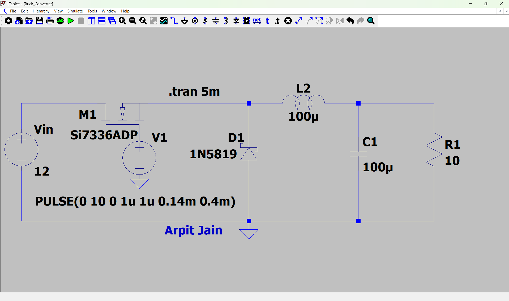
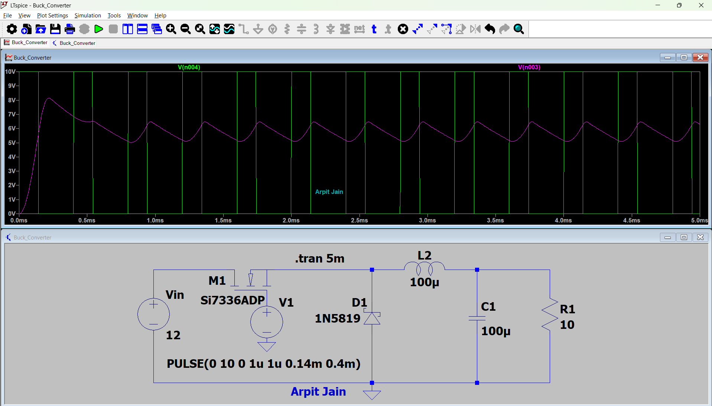
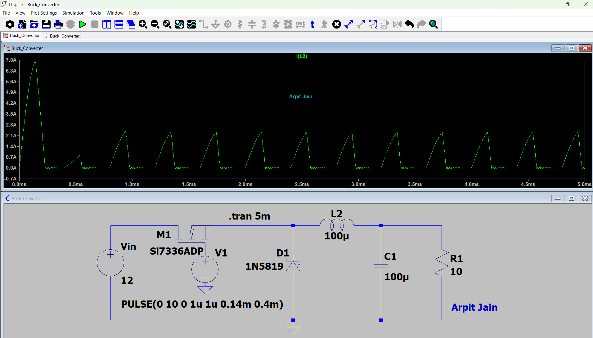
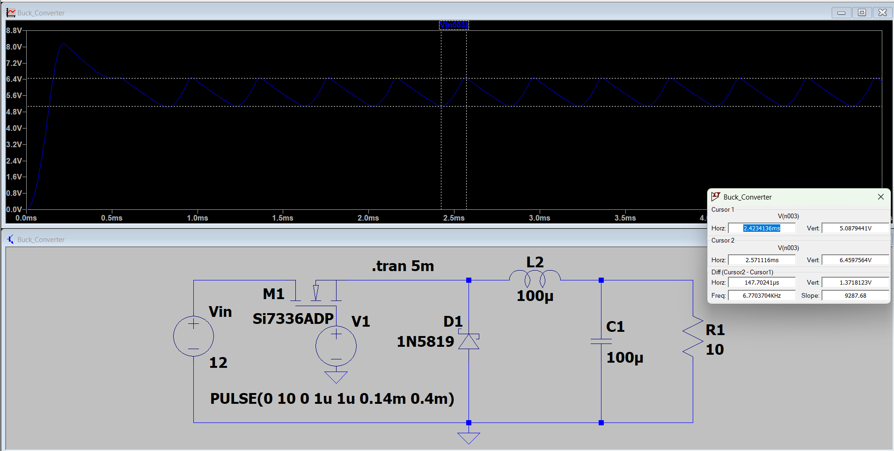
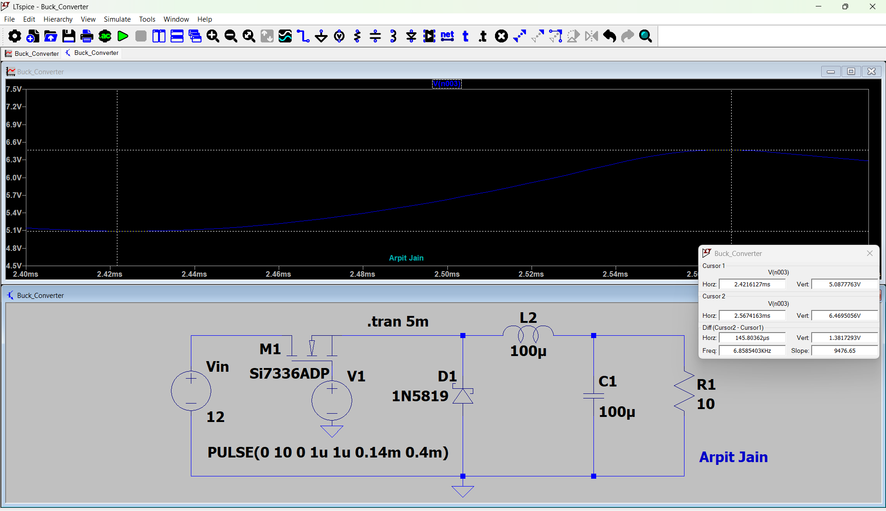

# Buck Converter Simulation in LTspice

> Design and transient simulation of a step-down (buck) DC-DC converter using a MOSFET switch, Schottky diode, LC filter and resistive load — **12 V input, 35 % duty cycle, 2.5 kHz switching frequency.**

**Author:** Arpit Jain
**Tool:** LTspice XVII / 24
**Analysis:** Transient (`.tran 5m`)

---

## Table of Contents

1. [Introduction](#-introduction)
2. [Buck Converter Theory](#-buck-converter-theory)
3. [Circuit Description](#-circuit-description)
4. [Design Parameters](#-design-parameters)
5. [Simulation Results](#-simulation-results)
   - [Result 1 – Gate Pulse & Output Voltage](#result-1--gate-pulse--output-voltage)
   - [Result 2 – Inductor Current](#result-2--inductor-current)
   - [Result 3 – Output Voltage Ripple (Cursor Measurement)](#result-3--output-voltage-ripple-cursor-measurement)
   - [Result 4 – Zoomed View of One Switching Cycle](#result-4--zoomed-view-of-one-switching-cycle)
6. [Result Summary Table](#-result-summary-table)
7. [Discussion: Why Is Vout Higher Than D × Vin?](#-discussion-why-is-vout-higher-than-d--vin)
8. [How to Run the Simulation](#-how-to-run-the-simulation)
9. [Repository Structure](#-repository-structure)
10. [Possible Improvements](#-possible-improvements)
11. [Conclusion](#-conclusion)

---

## Introduction

A **buck converter** is a type of switching DC-to-DC converter that delivers an output voltage which is **less** than its input voltage. This converter finds extensive application in battery-operated equipment, power to microcontrollers, LED driving circuits, and point-of-load regulation.

This project simulates a buck converter in **LTspice** and studies:

- Gate drive and output voltage behaviour
- Inductor current waveform
- Output voltage ripple
- Start-up transient and steady-state operation

---

## Buck Converter Theory

### Working principle

A buck converter has two operating states in every switching period **T**:

| State | Switch (M1) | Diode (D1) | What happens |
|-------|-------------|------------|--------------|
| **ON** (0 → D·T) | Closed | Reverse biased (off) | Source charge the inductor and load. Inductor current rises and energy is stored in the magnetic field. |
| **OFF** (D·T → T) | Open | Forward biased (on) | Inductor keeps current flowing through the diode (discharging). Stored energy is released to the load and current falls. |

The capacitor **C1** smooths the pulsating inductor current so the load sees an almost-DC voltage.

### Key equations

**Ideal output voltage (continuous conduction mode, CCM):**

```
Vout = D × Vin
```

**Duty cycle:**

```
D = Ton / T
```

**Inductor current ripple (CCM):**

```
ΔIL = (Vin − Vout) × D × T / L
```

**Output voltage ripple (CCM):**

```
ΔVout = ΔIL / (8 × f × C)
```

**Boundary between CCM and DCM (critical inductance):**

```
L_crit = (1 − D) × R × T / 2
```

If `L < L_crit`, the inductor current falls to zero during each cycle and the converter works in **Discontinuous Conduction Mode (DCM)**, where `Vout ≠ D × Vin`.

---

## Circuit Description



*Figure 1 – LTspice schematic of the buck converter.*

| Component | Part / Value | Role |
|-----------|--------------|------|
| **Vin** | 12 V DC | Input source |
| **M1** | Si7336ADP (N-channel MOSFET) | High-side switch |
| **V1** | PULSE(0 10 0 1u 1u 0.14m 0.4m) | Gate drive signal |
| **D1** | 1N5819 (Schottky) | Freewheeling diode |
| **L2** | 100 µH | Energy-storage inductor |
| **C1** | 100 µF | Output filter capacitor |
| **R1** | 10 Ω | Load resistor |

**Gate pulse definition:** `PULSE(Vinitial=0 Von=10 Tdelay=0 Trise=1u Tfall=1u Ton=0.14m Tperiod=0.4m)`

---

## Design Parameters

| Parameter | Value |
|-----------|-------|
| Input voltage (Vin) | 12 V |
| Gate drive amplitude | 10 V |
| Switching period (T) | 0.4 ms |
| Switching frequency (f) | 2.5 kHz |
| On-time (Ton) | 0.14 ms |
| Duty cycle (D) | 0.14 / 0.4 = **0.35 (35 %)** |
| Inductor (L) | 100 µH |
| Capacitor (C) | 100 µF |
| Load (R) | 10 Ω |
| Ideal Vout (D × Vin) | 12 × 0.35 = **4.2 V** |
| Critical inductance (L_crit) | 0.65 × 10 × 0.4 ms / 2 = **1.3 mH** |
| Simulation time | 5 ms |

> Since L = 100 µH is far below L_crit = 1.3 mH, the converter is expected to operate in **DCM** (confirmed in Result 2).

---

## Simulation Results

### Result 1 – Gate Pulse & Output Voltage



*Figure 2 – Gate drive V(n004) in green and output voltage V(n003) in magenta, 0 – 5 ms.*

**Explanation**

-**Green trace:** It is the 0-10 V PWM gate signal with a period of 0.4 ms (2.5 kHz), resulting in **12-13 pulses in 5 ms**.
- **Magenta trace**: Output voltage starts rising from 0 V when the circuit is turned on, **reaches a value of about 8.1 V in overshoot around 0.2 ms**, and finally reaches a steady ripple around 1 ms.
- In the steady state, the output oscillates between **5.1 V and 6.5 V, with the average being about 5.7 V**.
- Output increases when the switch is closed (capacitor charges through the inductor), and decreases when the switch is open (capacitor discharges through the load) resulting in the characteristic **sawtooth-shaped ripple** of a buck converter.

---

### Result 2 – Inductor Current



*Figure 3 – Inductor current I(L2), 0 – 5 ms.*

**Explanation**

- As the circuit starts, the capacitor will be discharged and therefore the current through the inductor peaks at **about 7 A** on the first pulse (inrush when C1 charges).
- The current in each cycle **increases to 2.3 - 2.4 A** and then **decreases to 0 A** before remaining constant at zero for a portion of the period.
- The waveforms above show the current is increasing and then falling to zero, thus the circuit operates in **Discontinuous Conduction Mode (DCM)**, as expected from `L < L_crit`.
- Inductor current average ≈ ½ × 2.4 A × (≈ 0.2 ms / 0.4 ms) ≈ **0.6 A**, which matches the load current `Vout / R ≈ 5.7 / 10 ≈ 0.57 A`.

---

### Result 3 – Output Voltage Ripple (Cursor Measurement)



*Figure 4 – Output voltage V(n003) with cursors placed on one minimum and one maximum.*

| Measurement | Cursor 1 (min) | Cursor 2 (max) | Difference |
|-------------|----------------|----------------|------------|
| Time | 2.4234 ms | 2.5711 ms | 147.7 µs |
| V(n003) | 5.0879 V | 6.4598 V | **1.3718 V** |

**Explanation**
- Cursors have a **ripple of ≈ 1.37 V** from peak to peak.
- The time interval of the ascending portion, from the minimum to the maximum value, is ≈ **148 µs**, which is nearly the 140 µs on-time of the switch, since the output voltage increases only when energy is supplied.
- *(Note: the "frequency" of 6.77 kHz shown in the cursor box is the reciprocal of the cursor spacing, not the switching frequency, which is 2.5 kHz).*
- The ripple is quite large (~24% of the output voltage) due to the small value of capacitor C1 and the low switching frequency.

---

### Result 4 – Zoomed View of One Switching Cycle



*Figure 5 – Zoomed plot of V(n003) between 2.40 ms and 2.56 ms.*

| Measurement | Cursor 1 | Cursor 2 | Difference |
|-------------|----------|----------|------------|
| Time | 2.4216 ms | 2.5674 ms | 145.8 µs |
| V(n003) | 5.0878 V | 6.4695 V | **1.3817 V** |

**Explanation**
- Looking closer, we see that the output starts flat at its minimum (≈ 5.09 V) and rises steadily to its maximum (≈ 6.47 V) in ≈ 146 µs before starting to decrease again.
- This flat portion represents the time when there is no inductor current, and the capacitor provides the load current alone.
- The increase has a smooth curve due to the linear increase in the inductor current and the integrating effect of the capacitor.
- The outcome (1.38 V ripple) agrees well with the earlier result (1.37 V).

---

## Result Summary Table

| Quantity | Value |
|----------|-------|
| Switching frequency | 2.5 kHz |
| Duty cycle | 35 % |
| Ideal Vout (CCM formula) | 4.2 V |
| **Simulated Vout (average)** | **≈ 5.7 V** |
| Output voltage maximum | ≈ 6.47 V |
| Output voltage minimum | ≈ 5.09 V |
| **Peak-to-peak ripple** | **≈ 1.37 – 1.38 V** |
| Start-up overshoot | ≈ 8.1 V |
| Inductor peak current (start-up) | ≈ 7 A |
| Inductor peak current (steady state) | ≈ 2.4 A |
| Average load current | ≈ 0.57 A |
| Conduction mode | **DCM** |

---

## Discussion: Why Is Vout Higher Than D × Vin?

The simulated average output (~5.7 V) is higher than the ideal CCM value of 4.2 V. Two effects explain this:

1. **Discontinuous conduction mode.** The CCM formula `Vout = D × Vin` only holds when inductor current never reaches zero. In DCM the output voltage becomes higher than `D × Vin` for the same duty cycle, since the load gets energy from the inductor and capacitor without the diode clamping the switch node for the full off-time.

2. **Gate drive limitation of the high-side N-MOSFET.** As the source of the gate is V1, the MOSFET will conduct only when `Vgs = 10 V − Vsource` exceeds the threshold voltage. Therefore, the switch node will be unable to reach 12 V; it will stop at about 8 V, just like the ≈ 8.1 V peak that is achieved at the beginning in Figure 2. The effective input voltage is less than 12 V, bringing the value below the one for DCM.

The final ≈ 5.7 V is the combined outcome of these effects plus small diode and MOSFET conduction losses. 

---


## Repository Structure

```
Buck-Converter-LTspice/
│
├── README.md
├── Buck_Converter.asc          # LTspice schematic
├── images/
│   ├── 01_schematic.png
│   ├── 02_gate_and_output_voltage.png
│   ├── 03_inductor_current.png
│   ├── 04_output_ripple_cursors.png
│   └── 05_output_zoomed_rise.png
└── LICENSE
```

---

## Possible Improvements

- **Increase L to ≥ 1.3 mH** so the converter runs in CCM and `Vout` approaches the expected 4.2 V.
- **Increase C1 or switching frequency** (e.g. 50 – 100 kHz) to reduce the ~1.4 V ripple dramatically.
- **Add closed-loop control** (PWM controller with feedback) to regulate the output at a fixed target voltage.
- **Replace the diode with a synchronous MOSFET** to improve efficiency.
- Add **efficiency, load-step and line-step** analyses.

---

## Conclusion

Design and simulation of a Buck Converter using LTSpice with values: Vin = 12 V, D = 35%, f = 2.5 kHz, L = 100 µH, C = 100 µF, and R = 10Ω was done, showing step-down characteristics. 12V input voltage was converted to an average output voltage of **5.7 V** with a **peak-to-peak ripple voltage of 1.37 V** and a start-up overshoot of 8.1 V. The Inductor current had a peak current of 2.4A and zero current per cycle showing that the converter operates on **Discontinuous Conduction Mode** since the inductor value is less than 1.3mH.

Overall, the project verifies the fundamental operation of the buck converter — switching, energy storage in the inductor, freewheeling through the diode and smoothing by the output capacitor — and highlights the key design trade-offs among inductance, capacitance, frequency and conduction mode.

---

## 👤 Author

**Arpit Jain**
*Power Electronics – Buck Converter Simulation Project*
